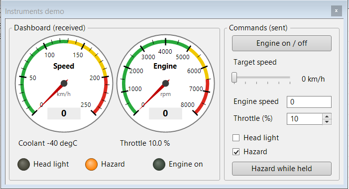
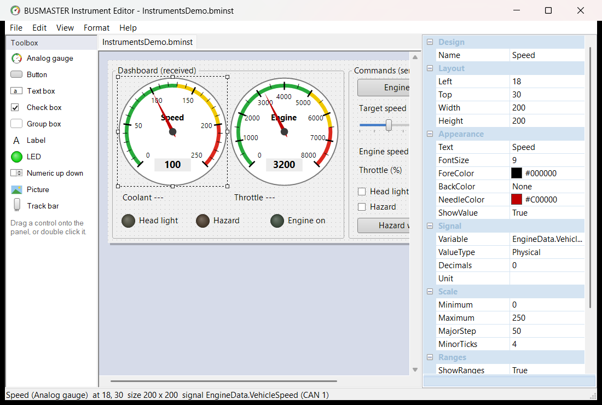

# Instruments in BUSMASTER-NG

Instruments are panels of controls (gauges, LEDs, buttons, track bars...) that show the values of signals as frames
are received, and send frames when you use them. You draw them in the **Instrument Editor** and show them in
BUSMASTER with **Instruments → Import**.

The original BUSMASTER had this as a commercial add-on of Bosch (see the leaflet
[BUSMASTER Instruments Add-on info.pdf](https://github.com/rbei-etas/busmaster-documents/blob/9a6383a/BUSMASTER%20Instruments%20Add-on%20info.pdf));
it was never published. BUSMASTER-NG has its own version, written from that description: a plugin
(`BusmasterPlugins\Instruments.dll`) that uses the plugin interface and the variable layer that the open source
BUSMASTER already had for it.

## Trying it

`Examples\Instruments` has a database and an instrument made for it:

1. *CAN → Load DBC*: `Examples\Instruments\InstrumentsDemo.dbc` (on channel 1).
2. *Instruments → Import*: `Examples\Instruments\InstrumentsDemo.bminst`.
3. Select the *Simulation* driver (it gives back the frames sent) and *Connect*.
4. Use the controls on the right of the panel: the frames appear in the Message window and come back to the gauges
   and LEDs on the left.

## The ribbon tab Instruments

| Button | |
|---|---|
| **New** | opens the Instrument Editor with a new instrument |
| **Import** | shows one or more instruments (`.bminst`) in BUSMASTER |
| **Close All** | closes the instruments shown |

The instruments shown are saved in the configuration (`.cfx`) with their place, and come back when it is loaded.
Right click an instrument for *Edit in the Instrument Editor*, *Reload* and *Close*. When the editor saves a file
that is shown, the instrument is loaded again.

## The Instrument Editor

- **Toolbox**: drag a control onto the panel, or double click it.
- **Panel**: click to select, Ctrl+click or a rectangle to select several; drag to move (on a grid of 8 pixels; hold
  Alt for no grid), the handles to resize, the handle at the bottom right corner of the panel to resize the panel.
  Arrow keys move by one pixel (Ctrl: by the grid), Shift+arrows resize. Double click a control to choose its signal
  (or the image of a picture).
- **Property window** (F4): the properties of the selected control, or of the panel when nothing is selected. With
  several controls selected, a change applies to all of them.
- **Signal**: the property *Variable* (or *Edit → Choose Signal*, Ctrl+L) lists the signals of the databases
  associated in BUSMASTER, by bus, channel, database and message, with a search box.
- **File**: New, Open, Save, Save As, Close, Close All, Close All But This One. Several instruments open at once,
  in tabs.
- **Edit**: Undo / Redo (100 steps), Cut, Copy, Paste (also between instruments), Delete, Select All.
- **View**: Property Window, Toolbox, Snap to Grid.
- **Format**: Align (lefts, centers, rights, tops, middles, bottoms, to grid), Make Same Size, Horizontal and
  Vertical Spacing (make equal, increase, decrease, remove), Center in Form, Order (bring to front, send to back).
  The first control selected is the reference.

## The controls

| Control | Shows the signal | Sends the signal |
|---|---|---|
| Analog gauge | needle, digits, green / yellow / red ranges | |
| LED | on when the value is at least *Threshold* | |
| Label | its text followed by the value and the unit | |
| Text box | the value | the value typed, on Enter (unless *ReadOnly*) |
| Button | (toggle: pressed while the value is the pressed value) | *Momentary*: pressed value while held down, released value when let go; *Toggle*: one or the other at each click; *Send*: the pressed value at each click |
| Check box | checked when the value is the checked value | checked or unchecked value |
| Numeric up down | the value | the value changed by the arrows, the mouse wheel or typed |
| Track bar | the value | the value where it is dragged (rounded to *Step*) |
| Group box, Picture | | |

Each control with a signal can show the *Physical* value (scaled, with the unit of the database) or the *Raw*
value. The values arrive through the variable layer of BUSMASTER and are shown 20 times a second.

A control sends the frame of its message with the new value of its signal; the other signals of that message keep
the values this instrument sent before (0 at first). The frame goes out on the channel of the signal.

## The file

An instrument is an XML file (`.bminst`, UTF-8): the panel and, for each control, its type and properties. Pictures
are stored in the file. A signal is written as a variable path of BUSMASTER:

    SIGNAL:<bus>:CHANNEL<n>:<database>:<message>:<signal>      CHANNEL0 is channel 1

`<database>` is the name BUSMASTER gives the database: the name of its file without the dot (`InstrumentsDemodbf`
for `InstrumentsDemo.dbf`). An instrument works with any configuration where a database of that name is associated
on that channel; a signal that is not found shows `---` until it is (the instrument looks again every few seconds).

## Limits

- Tested with CAN on the Simulation driver. The LIN part (the variable layer reads and sends LIN frames too) has not
  been tried on a LIN bus.
- CAN FD: frames of more than 8 bytes would be sent as CAN FD, but the database engine of BUSMASTER refuses such
  messages (see [dbc-support.md](dbc-support.md)), so in practice the signals are those of classic CAN frames.
- J1939 signals are not offered.
- The editor and the instruments are in English only.
